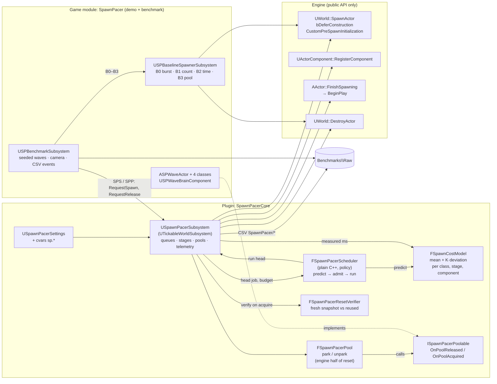

# 02 · System Architecture: SpawnPacer (v1.0, final)

**Phase:** 3 (Architecture), **final**, 2026-11-21. It replaces the one-paragraph plan in the project README; the changes are listed in §15.
**Engine:** UE 5.8.4. Every engine behaviour relied on here is verified in [01b_Research_Findings.md](01b_Research_Findings.md); references like `01b #3` point to its §1 table.
**Rule:** this is the design *before* code. If implementation proves a decision wrong, this file is updated in the same step.

---

## 1. Goals and non-goals

**Goals**
1. Spawn, pool-acquire, pool-release and destroy actors inside a per-frame **millisecond budget** on the game thread.
2. **Never start a job that is predicted not to fit**, using a per-class, per-stage cost that the system learns while it runs.
3. Split one actor's spawn **only at the engine's public seams** (01b §0): the deferred seam, and per native component.
4. Keep the request order: within one priority, actors finish spawning (and run BeginPlay) in the order they were requested, and a batch reports when it is complete.
5. Provide a pool whose reset is **verified** against the actor's own fresh state, so a reset bug is reported instead of found by a player.
6. Keep the policy (which job runs) **testable without a world**, separate from the mechanism (how a job touches the engine).
7. Run every configuration from the same packaged build, with the same workload, switched by command line.

**Non-goals (v1)**
- Spawning off the game thread (not possible, 01b §2.7).
- Asynchronous physics-state creation (Experimental, streaming-only path, 01b #10).
- Splitting Blueprint construction-script components (they register inside `FinishSpawning`, 01b #5).
- Networked spawning and replication (12_Future_Scalability.md).
- Choosing *what* to spawn (distance rings, relevance): that is the game's job, or SpawnBudget's. SpawnPacer decides *when*.

## 2. The core idea in plain words

Every request becomes a short sequence of **jobs**. Each job is one indivisible piece of engine work:

```text
fresh spawn, whole:          [Spawn]                                  (SpawnActor, plain)
fresh spawn, deferred split: [Construct] ... [Finish]                 (SpawnActorDeferred | FinishSpawning)
fresh spawn, per component:  [Construct] [Register c1] ... [Register cN] [Finish]
pooled:                      [Acquire]        and later  [Release]
not pooled, leaving:         [Destroy]
```

Each frame the scheduler looks at the job at the head of the queue and asks the **cost model** what it will cost:

```text
predicted = mean(class, stage) + K × deviation(class, stage)     (K = 2)
run it     if  spent + predicted ≤ budget
           or  nothing has run yet this frame      (progress: counted as "forced" if predicted > budget)
otherwise  stop for this frame                      (never start a job that won't fit)
after it ran: spent += measured;  cost model learns from measured
```

- **Prediction before, not a check after.** Mass and SpawnBudget check the clock *between* items, so the item that crosses the line runs to completion (01b §5). SpawnPacer asks first.
- **The cost model is the RFC 6298 estimator** (the way TCP predicts round-trip times): a smoothed mean and a smoothed mean deviation per key, two numbers each, α = 1/8 and β = 1/4 ([raw notes B §B7](Phase2_Raw_Notes/B_measurement_and_pooling.md)). A key it has never seen is predicted as the **whole budget**, so its first sample runs alone in a frame and can't push a frame over.
- **Head of line.** A request keeps the head of its queue until its last stage is done. So a boss's components register on consecutive jobs, the actor stays half-spawned for as few frames as possible, and BeginPlay order equals request order (01b #8).
- **The pool is a second path for the same requests,** not a different system: an acquire is one job with its own predicted cost, a release is another.

**Rejected alternatives:**

| Alternative | Why we rejected it |
|---|---|
| Check the clock after each job (Mass, SpawnBudget) | Overruns by one job. That is the very flaw this project measures (H4) |
| A fixed count per frame (PoolManager, the forum pattern) | Cost differs per class by more than 10× (H2, H3) |
| Fill the remaining budget with smaller jobs from further back (look-ahead / bin packing) | Better budget use, but breaks the request order (BeginPlay order) and leaves more actors half-spawned. Kept as a measured option for later (§12) |
| Mean only (no deviation term) | Half of all jobs would cost more than predicted; with a full budget that means frequent small overruns |
| A fixed cost table entered by hand | Breaks when content changes, the same reason hand-tuned "N per frame" breaks. The model learns online; a table could *seed* it later (§12) |
| Round-robin over stages of all requests | Many actors would sit half-spawned at once, visible but not ticking |

## 3. Modules and where they live

```text
D:\UNREAL PORTFOLIO\P02_SpawnPacer\SpawnPacer\                      ← the UE project
├── SpawnPacer.uproject
├── Source\SpawnPacer\{Public,Private}\                              ← game module: demo + benchmark only
├── Plugins\SpawnPacerCore\Source\SpawnPacerCore\{Public,Private}\   ← the reusable system
└── Config\  Content\
D:\UNREAL PORTFOLIO\P02_SpawnPacer\Tools\                            ← Python stats + run scripts, build scripts
```

| Module | Type | Responsibility | Depends on |
|---|---|---|---|
| `SpawnPacerCore` (plugin) | Runtime | Request queues, scheduler policy, cost model, staged spawn mechanism, pool, reset contract and verifier, settings, cvars, telemetry | `Core`, `CoreUObject`, `Engine`; `DeveloperSettings` from step S9 |
| `SpawnPacer` (primary game module) | Game | Demo actor classes, the benchmark director, the four baseline spawners | `SpawnPacerCore` |
| `Tools\` | Python, batch | CSV statistics with windows and hitch counts, run orchestration with P-core pinning, build/package/smoke scripts | — |

**The dependency rule:** game → plugin, never the reverse. The plugin knows nothing about drones, bosses, waves or benchmarks.

**Naming:** module names must be unique across the engine and project ([research/04](Research/04_local_engine_verification.md) §0), hence `SpawnPacerCore`. Public plugin headers use 5.8's export convention (`#define UE_API SPAWNPACERCORE_API` … `#undef UE_API`), as UE5-UpdateBudget does.

## 4. Classes

### 4.1 Plugin `SpawnPacerCore` (8 pieces, each with a reason)

| Class | Kind / base | Responsibility | Why it exists, and what we rejected |
|---|---|---|---|
| `USpawnPacerSubsystem` | `UTickableWorldSubsystem` (Game and PIE only) | The **mechanism and public API**: `RequestSpawn`, `RequestRelease`, `Prewarm`, batches; owns the queues, pools and cost model; runs one frame of jobs in `Tick`; executes each stage against the engine; publishes telemetry | Its lifetime is exactly the world's. Its `Tick` runs once per frame after `TG_PostPhysics` (`Private/LevelTick.cpp:1778–1821`), so new actors take part in the next frame's physics and ticks. *Rejected:* a manager actor (can be deleted, duplicated, or missing from a map); a custom `FTickFunction` in `TG_PrePhysics` (UE5-UpdateBudget needed one to match a tick group; spawn work has no group to match, so the simpler tickable is enough); a game-instance subsystem (outlives worlds, but pooled actors die with their world) |
| `FSpawnPacerScheduler` | Plain C++ struct (no UObject) | The **policy**: given a budget and three callbacks (*peek head*, *predict*, *run head*), runs jobs by the rule in §2 and returns frame statistics | Unit-testable with fake jobs and fake costs, no world needed (S4). *Rejected:* the loop inside the subsystem, testable only in a running game |
| `FSpawnCostModel` | Plain C++ struct | Per key **(class, stage, component name)**: mean and mean deviation; `Predict`, `Observe`, cold-start rule | Same reason: pure and testable. Keys use the component's `FName` because default subobjects have the same name in every instance of a class |
| `FSpawnPacerRequest` | Plain C++ struct (inside the subsystem's arrays) | One request's **state machine**: kind, class, transform, priority, batch, current stage, `TWeakObjectPtr` to its actor, the held-back components, an optional `Initialize` callback | Small and explicit; the stages in §2 are its states (§6.2). *Rejected:* one `UObject` per request (GC churn for 500 requests per wave) |
| `FSpawnPacerPool` | USTRUCT, stored in a `UPROPERTY` map on the subsystem | Per class: parked actors plus, for each, which components were ticking; `Park` and `Unpark` implement the engine half of the reset contract (§11) | The `UPROPERTY` map keeps parked actors visible to GC. *Rejected:* a separate pool `UObject` (one more lifetime to manage, no gain) |
| `ISpawnPacerPoolable` / `USpawnPacerPoolable` | `UINTERFACE` with two `BlueprintNativeEvent`s: `OnPoolReleased`, `OnPoolAcquired` | The **game half** of the reset contract: what the actor means (health, AI state). Blueprint actors can implement it too | An interface, because unrelated classes (an enemy, a projectile) share only this contract. Same shape as Mass's and SpawnBudget's interfaces, deliberately: users already know it |
| `FSpawnPacerResetVerifier` | Plain C++ struct | **Snapshot** an actor and its components (every `UPROPERTY` exported as text, plus structure: component set, attached actors, tick states, latent actions) and **compare** a reused actor against its own fresh snapshot; report leaks by kind | The reason a pool can be trusted (SC5). Off in timing runs (`sp.Pool.VerifyReset 0`), on in soak runs. *Rejected:* per-class hand-written reset checks (they test only what the author remembered, which is the bug) |
| `USpawnPacerSettings` + `FSpawnPacerClassRule` | `UDeveloperSettings` (`config=Game, defaultconfig`) + USTRUCT (step S9) | Budget, K, cold-start rule, verifier switch; per class: split mode (`Whole`, `Deferred`, `PerComponent`), pool cap, properties the verifier ignores | One designer-editable place. *Rejected:* `UDeveloperSettingsBackedByCVars` (its cvar sync is editor-only, as UE5-UpdateBudget's 01b #11 found); a Data Asset (a loading step for no gain yet) |

Three of the eight are UObject types (the subsystem, the interface, the settings); the other five are structs (only `FSpawnPacerPool` is reflected, so GC can see the parked actors), so scheduling itself allocates no UObjects.

**Console variables** (`ECVF_Default`, so they can be set from the command line and config; cheat cvars can't be, per UE5-UpdateBudget 01b #11):

| Cvar | Meaning |
|---|---|
| `sp.Enabled` | `0`: requests run immediately and completely (pass-through, for A/B and overhead tests); `1`: paced |
| `sp.BudgetMs` | Override the settings budget; `< 0` = use settings |
| `sp.Pool.VerifyReset` | `1`: snapshot on first use and compare on every acquire |
| `sp.Debug` | On-screen queue length, spent ms, last frame's jobs |

**Telemetry:** CSV category `SpawnPacer`, published **once per frame** (UE5-UpdateBudget measured ≈ 50 ns per `CSV_CUSTOM_STAT` call, so per-job publishing is avoided): `WorkMs`, `PredictedMs`, `Jobs`, `ForcedJobs`, `ColdJobs`, `Pending`, `Completed`, `Dropped`, per-stage ms (`ConstructMs`, `RegisterMs`, `FinishMs`, `AcquireMs`, `ReleaseMs`, `DestroyMs`), `ResetLeaks`. CSV events `SpawnPacer/BatchComplete`. A native multicast delegate `OnBatchComplete(BatchId)` and a Blueprint-assignable one.

### 4.2 Game module `SpawnPacer` (demo and benchmark only)

| Class | Base | Responsibility |
|---|---|---|
| `ASPWaveActor` | `AActor`, implements `ISpawnPacerPoolable` | The demo actor base: a root, a `USPWaveBrainComponent`, and N static-mesh components. Each subclass's constructor calls one shared protected helper with its own N (UObject constructors can't take extra arguments of their own), so every subclass has its own CDO and component set, and the cost model learns per class |
| `ASPDrone`, `ASPCrate`, `ASPGrunt`, `ASPBoss` | `ASPWaveActor` | 1 / 3 / 6 / 24 mesh components (01 §6.1); the Drone moves every tick |
| `USPWaveBrainComponent` | `UActorComponent` | Gameplay state as `UPROPERTY`s (health, ammo, state), a calibrated amount of BeginPlay work, a repeating timer, simulated use during the actor's life (damage, an attached marker actor, a runtime component), and the correct reset in `OnPoolAcquired`/`OnPoolReleased` |
| `ASPLeakyGrunt` | `ASPGrunt` | The **seeded-defect** class for SC5: `-SPSeedLeak=<kind>` makes its reset skip exactly one thing |
| `USPBenchmarkSubsystem` | `UWorldSubsystem` (Game/PIE) | The director: reads `-SP…=` values, places the fixed camera, builds the seeded wave list, drives the 3-cycle script, forces the scripted GC, writes CSV events and metadata, measures wave latency, writes a run report, exits |
| `USPBaselineSpawnerSubsystem` | `UTickableWorldSubsystem` (Game/PIE) | Baselines B0–B3 (01 §6.2), each a competent, simple implementation, timing its own spawn work with the same clock as SpawnPacer |

UE5-UpdateBudget used the same director-as-world-subsystem pattern: the project has no hand-authored map, so nothing would place a director actor.

## 5. Overview diagram



## 6. Per-frame flow

### 6.1 One frame

```mermaid
sequenceDiagram
  participant LT as Level tick (after TG_PostPhysics)
  participant S as USpawnPacerSubsystem
  participant P as FSpawnPacerScheduler
  participant C as FSpawnCostModel
  participant E as Engine (SpawnActor / RegisterComponent / FinishSpawning / DestroyActor)
  LT->>S: Tick(DeltaTime)
  S->>S: 1. move requests made since last frame into the queues
  S->>P: 2. RunFrame(budget, PeekHead, Predict, RunHead)
  loop while a head job exists
    P->>C: Predict(key of head job)
    C-->>P: mean + K·deviation (cold key: whole budget)
    alt jobs run this frame > 0 and spent + predicted > budget
      P-->>S: stop (job stays at the head)
    else
      P->>S: RunHead()
      S->>E: one stage of the head request
      E-->>S: returns (time measured around the call)
      S->>C: Observe(key, measured)
      S->>S: advance the request's stage, or complete it (callback, batch count)
    end
  end
  P-->>S: frame stats (spent, jobs, forced, cold)
  S->>S: 3. CSV stats once; BatchComplete events
```

### 6.2 One request's states

```mermaid
stateDiagram-v2
  [*] --> Queued
  Queued --> Constructed: Construct job (SpawnActor deferred; held-back components have bAutoRegister = false)
  Queued --> Live: Spawn job (Whole: plain SpawnActor)
  Queued --> Live: Acquire job (pool has a parked actor)
  Constructed --> Constructed: Register job (one held-back component, parent first)
  Constructed --> Live: Finish job (FinishSpawning → BeginPlay), only when no component is held back
  Live --> Parked: Release job (pooled class)
  Live --> [*]: Destroy job
  Parked --> Live: Acquire job
  Constructed --> [*]: actor became invalid (destroyed behind our back): dropped and counted
```

### 6.3 Policy, in code-sized pseudocode (the real code mirrors this)

```text
Spent = 0; Jobs = 0
while Head = PeekHead():
    Predicted = Cost.Predict(Head.Key)              // cold key → Budget
    if Jobs > 0 and Spent + Predicted > Budget: break
    Forced += (Jobs == 0 and Predicted > Budget)
    Measured = RunHead()                            // one engine stage, timed with FPlatformTime::Cycles64
    Cost.Observe(Head.Key, Measured)
    Spent += Measured; Jobs += 1
```

Cost model update per key (RFC 6298 §2, α = 1/8, β = 1/4):

```text
first sample R:   Mean = R;  Dev = R / 2
later sample R:   Dev  = (1 − β)·Dev + β·|Mean − R|      // uses the old Mean
                  Mean = (1 − α)·Mean + α·R
Predict           = Mean + K·Dev                        // K = 2
```

## 7. Defaults and why

| Setting | Default | Reasoning |
|---|---|---|
| `BudgetMs` | **2.0 ms** | About 12% of a 60 fps frame, leaving room for the 500 live actors' own cost (calibrated to ≤ 12 ms, 01 §6.1). The same share UE5-UpdateBudget chose for its budget. Swept at 1, 2, 4 ms |
| `K` (deviation multiplier) | **2** | RFC 6298 uses K = 4 for a timeout, where being late is costly and waiting is cheap. Here an overestimate wastes budget (latency, SC4) and an underestimate overruns (SC3), so a smaller K is the balance. Checked against SC3/SC4 in Phase 8 |
| α, β | **1/8, 1/4** | RFC 6298's recommended values: react within a few samples, don't jump on one outlier |
| Cold key | **predict = whole budget** | Its first sample runs as the frame's only job, so it can't be the job that tips a full frame over |
| Split mode per class | **`Whole`** | The safest semantics (01b #7: split actors are visible but not ticking). Demo: Grunt `Deferred`, Boss `PerComponent`, chosen so the ablation shows what each seam buys |
| Priorities | **3 FIFO levels**: Background (pre-warm), Normal, High | Enough to let pre-warming never delay gameplay requests; FIFO inside each level keeps request order |
| Pool cap per class | **unlimited** (benchmark), settable | The benchmark needs exactly 500 parked actors; a game would cap it |
| Verifier | **off** in timing runs | Snapshots cost time and memory; the soak run turns it on |

## 8. Lifetime and safety rules

| Risk | Rule | Evidence |
|---|---|---|
| Spawning off the game thread | Everything runs in the subsystem's `Tick`, on the game thread | 01b §2.7 |
| The subsystem exists in editor worlds | `DoesSupportWorldType`: Game and PIE only (the default also allows Editor, `Private/Subsystems/WorldSubsystem.cpp:29–32`) | verified |
| A half-spawned actor is destroyed behind our back (level unload, gameplay) | Each request holds a `TWeakObjectPtr`; every stage first checks `IsValid`; an invalid request is dropped and counted (`Dropped` stat) | 01b #7 |
| A held-back component is registered after `FinishSpawning` | **Forbidden by the state machine:** `Finish` runs only when no component is held back | 01b #4 |
| A child component registered before its parent | Held-back components are registered in attachment order (parent first), as the engine does | `Actor.cpp:6237–6252` |
| Someone requests a spawn or a release from inside a stage (BeginPlay spawning more actors) | New requests go to an incoming list, merged into the queues at the start of the next frame; the queue being iterated is never modified mid-loop | the same deferral rule as UE5-UpdateBudget |
| A release is requested for an actor still being spawned | The request is marked cancelled; its next stage destroys (or finishes and parks) it instead of advancing | — |
| A parked actor is destroyed behind the pool's back | `Unpark` skips invalid entries (Mass does the same: it pops until it finds a valid actor, `MassActorSpawnerSubsystem.cpp:244–249`) | verified |
| Parked actors must not be garbage-collected, but must not outlive the world | Parked actors are held in a `UPROPERTY` map (GC-visible); the map is emptied in `Deinitialize`. They are also in the level's actor list, so the world destroys them on teardown | — |
| A parked actor keeps costing frame time | `Park` switches off the actor's tick **and every component tick** that was on (remembered), because `SetActorTickEnabled` touches only the actor (01b #12) | verified |
| A timer or latent action from the previous life fires in the next | `Park` clears timers (`ClearAllTimersForObject`) and latent actions (`RemoveActionsForObject`) for the actor and every component, unconditionally | 01b #11 |
| Gameplay code assumes BeginPlay per use | Contract: for a poolable class, BeginPlay is once-per-object setup; per-use setup belongs in `OnPoolAcquired` (documented on the interface) | 01b §2.3 |
| Pre-warm delays gameplay spawns | Pre-warm requests use the Background priority | — |

## 9. One workload for every configuration

The same seeded wave list (class order and transforms) is used in every configuration; only the spawner changes.

| Config | Who creates the wave | Who removes it | Set by |
|---|---|---|---|
| B0 | `USPBaselineSpawnerSubsystem`: plain `SpawnActor` × 500 in the request frame | `Destroy` × 500 in the despawn frame | `-SPConfig=B0` |
| B1 | same: queue; `SpawnActorDeferred` + `FinishSpawning`, K per frame | `Destroy`, K per frame | `-SPConfig=B1 -SPCountCap=K` |
| B2 | same: plain `SpawnActor` while elapsed < budget (check between items) | `Destroy` while elapsed < budget | `-SPConfig=B2` |
| B3 | same: pool filled in warm-up (unpaced); 500 un-hidden etc. in the request frame | 500 hidden etc. in the despawn frame | `-SPConfig=B3` |
| SPS | `USpawnPacerSubsystem`, spawn path, class split modes from settings | Destroy jobs | `-SPConfig=SPS` |
| SPP | `USpawnPacerSubsystem`, pool path; Background pre-warm in warm-up | Release jobs | `-SPConfig=SPP` |

**Equal measurement cost:** every spawner times its own work with `FPlatformTime::Cycles64` and publishes one value per frame (`SpawnPacer/WorkMs` or `SPBaseline/WorkMs`), so the measurement overhead is the same in every configuration. Wave completion is detected the same way everywhere: each demo actor's brain reports "I have begun play / I have been acquired" to the director.

## 10. C++ vs Blueprint

| C++ | Blueprint |
|---|---|
| Everything measured: scheduler, cost model, stages, pool, verifier, demo classes, director, baselines | `RequestSpawn` / `RequestRelease` / `Prewarm` are `BlueprintCallable`; `OnBatchComplete` is assignable; `ISpawnPacerPoolable` is `Blueprintable` so Blueprint actors can implement their reset; settings are edited in Project Settings |

Blueprint-only actors can be paced and pooled, but only as `Whole` or `Deferred`: their construction-script components can't be split (01b #5). That is stated in the settings tooltip.

## 11. The reset contract and its verifier

**The contract, in order:**

| Step | On `Release` (park) | On `Acquire` (unpark) |
|---|---|---|
| 1 | `ISpawnPacerPoolable::OnPoolReleased` (game state) | Restore transform (`ETeleportType::ResetPhysics`) |
| 2 | Clear timers and latent actions: actor + every component (enforced) | Restore collision and visibility to the fresh state |
| 3 | Remember which component ticks were on; switch off actor and component ticks | Restore the remembered ticks |
| 4 | Disable collision, hide, move to a park location | `ISpawnPacerPoolable::OnPoolAcquired` (game state) |
| 5 | — | **Verify** (if `sp.Pool.VerifyReset 1`), then the request's `Initialize` callback |

**The verifier:**
- **Fresh snapshot:** taken once per actor, right after its first `FinishSpawning` (before any use). For each `UPROPERTY` of the actor and of every component, the property's text form (`FProperty::ExportTextItem_InContainer`, 01b #13); dynamic multicast delegates export their bound invocation lists, so a leftover binding shows (`CoreUObject/Private/UObject/PropertyMulticastDelegate.cpp:231–261`). Plus structure: the component set (name and class), the number of attached actors, each component's tick-enabled state, the number of latent actions.
- **Check:** after every acquire, the same capture is compared with the fresh snapshot. Every difference is a **leak**, reported with object, property, fresh value and current value, counted by kind.
- **Ignored on purpose:** transform properties (`RelativeLocation`, `RelativeRotation`, `ComponentVelocity`), and properties a class rule lists as "per-spawn parameters". Every other exclusion found necessary in testing (engine bookkeeping that legitimately changes) is added with a written reason; the clean-class soak (SC5's 0-leak part) is the false-positive test that finds them.
- **What it can't see:** plain C++ members; state held in other objects about this actor (a squad manager's list); pending timers (cleared instead, and tested by effect). Stated in 13.

**Seeded defects for SC5** (`ASPLeakyGrunt`, one kind per run): actor property not reset · component property not reset · component added at run time and left · actor left attached · delegate left bound · component tick left in the wrong state. A separate functional check: a timer set during use never fires after reuse.

## 12. How it grows into a production game (not built now)

- **Seed the cost model** from a file written by a previous session (or a cook-time pass), so the first wave of a session isn't cold.
- **Look-ahead filling** within a batch when request order doesn't matter (props), as an opt-in per request.
- **Per-platform budgets** through device profiles setting `sp.BudgetMs`.
- **One budget with the rest of the frame:** feed spent time into a frame-level budget owner. UE5-UpdateBudget's scheduler is one such owner: a game could give SpawnPacer whatever that leaves.
- **Streaming and networking:** dedicated servers spawn replicated actors whose client-side spawn is driven by replication, outside our queue (12).
- **On top of a future engine API:** if a later engine version ships amortised spawning or pooling (01b #14), the subsystem's stage execution is replaced and the policy, cost model and verifier stay.
- **Async physics state:** an experiment driving `PreRegisterComponentWithWorld` for held-back components, once the path leaves Experimental (01b #10).
- **Reuse in later projects:** NavReadyPCG (P8) paces its generated actors through it; StateHandoff (P9) uses the verifier idea for its representation hand-off.

## 13. Known limits (stated, not hidden)

1. **Indivisible stages can still overrun.** One component's registration, one `FinishSpawning`, one acquire: if any alone exceeds the budget, its frame overruns. SC3 counts these as forced jobs.
2. **Latency is the price.** A wave appears over tens of frames. SC4 reports it.
3. **Split actors are visible but not ticking** between their stages (01b #7). Opt-in per class.
4. **Native components only** for per-component splitting (01b #5).
5. **Navigation relevance of late-registered components is unverified:** `PostRegisterAllComponents` notifies navigation when the first pass ends (01b §2.2). The demo map has no navmesh; a navmesh game must test it.
6. **The verifier sees reflected state only,** and exports every property of every component as text: fine for a soak test, too slow to leave on in a shipped game.
7. **Prediction needs repetition.** A class spawned once per session never gets a warm estimate; its spawn is treated as budget-sized.
8. **Fixed-step headline numbers.** Wave latency is in simulated time; the uncapped run checks SC1 under real deltas.
9. **The demo classes are synthetic** (engine cube meshes, a calibrated BeginPlay loop). They are calibrated to realistic per-actor costs, but are not a shipped game's content.

## 14. Rejected alternatives (design level)

| Alternative | Why not |
|---|---|
| Spawning on worker threads | Not supported by the engine (01b §2.7) |
| Async physics-state creation for spawned actors | Streaming-only, Experimental, read-only switch (01b #10). Recorded for later (§12) |
| `p.EnableDeferredPhysicsCreation` | Defers only primitives without overlap events whose body setup has no physics meshes yet (01b §2.2), so it doesn't apply to already-cooked meshes, and it changes engine-wide behaviour |
| Hold back **all** components including the root | The root must exist first: children attach to it and the engine registers it first (`Actor.cpp:6208–6221`) |
| Let held-back components register after BeginPlay | `BeginPlay` would see missing components, and their own `BeginPlay` would run at registration (01b #4): a silent change in semantics |
| Pool without verification, as everyone does | That is the gap this project targets |
| Snapshot by duplicating the actor (`DuplicateObject`) | Much heavier than text, and duplicating an actor in a world has side effects (registration). Text export is enough to compare |
| Reset by re-running the class's constructor defaults (copying from the CDO) | Would wipe legitimate once-per-object setup done in BeginPlay, and still miss non-reflected state |

## 15. Changes from the project plan (README, 2026-11-20)

| Plan said | v1.0 says | Why |
|---|---|---|
| "The engine has no time-sliced spawn or general pool" | The engine's Mass spawner has both (Experimental, Mass-only); SpawnBudget and PoolManager too | 01b §5. The gap is narrowed to prediction, staged spawning at the seams, and verified reset |
| "Per-phase cost breakdown (construct, register, physics, BeginPlay)" | Stages are **construct / register (per component) / finish**. Physics state is created inside registration and can't be timed separately at plugin level; BeginPlay is inside `FinishSpawning` | 01b #2, #6. The engine's Insights scopes give the finer split for cross-checking (01b #9) |
| "Async physics-state creation (Experimental)" as a technology | Not used in v1 | 01b #10 |
| "Splitting may need engine changes" (main risk) | Splitting is possible at two seams with public API; everything finer needs engine changes | 01b §0 |
| Baselines: plain `SpawnActor`, deferred pattern, a pool | Plus B2, the check-between time cap, at the same budget | It is the existing pacers' model (Mass, SpawnBudget): the fair "best existing" bar |
