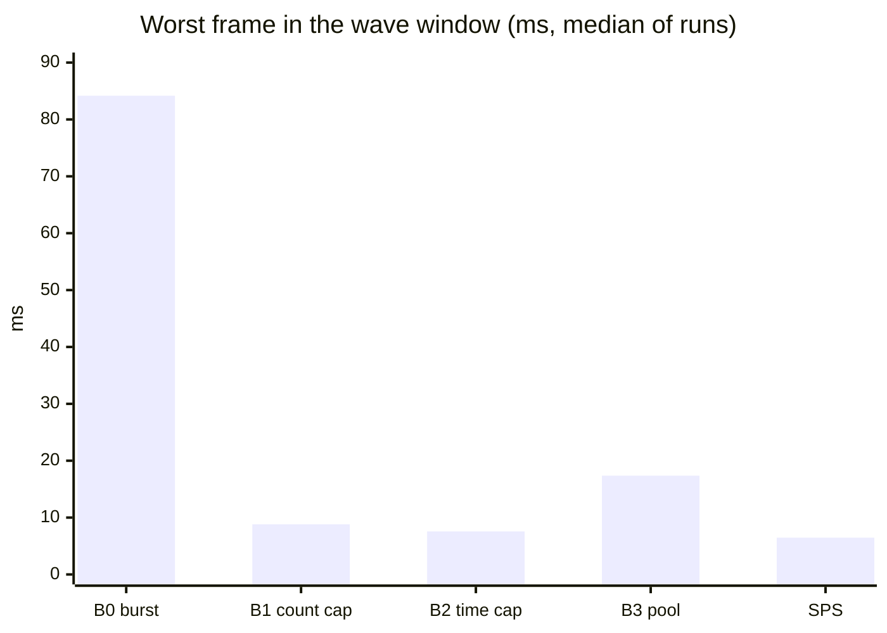
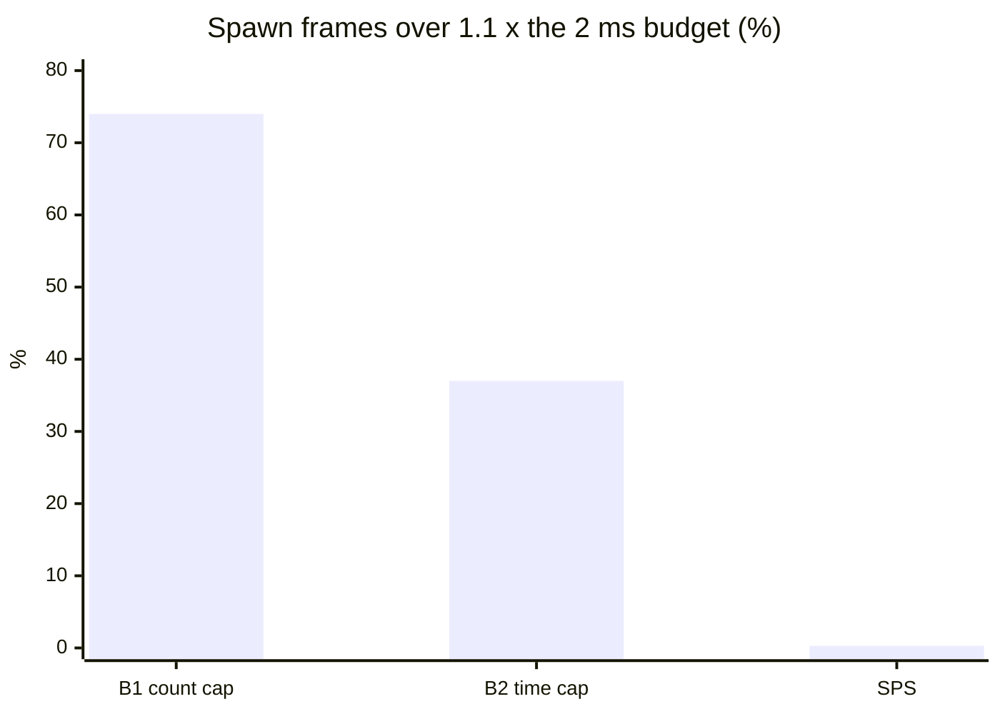

# P02 · SpawnPacer: hitch-free content entry

**Author:** Krish Gangani · [github.com/KrishGangani](https://github.com/KrishGangani)

**Domain:** Frame-time consistency · actor lifecycle · **Difficulty:** ★★★½☆ · **Engine:** UE 5.8.4

> **Status: Phase 5 ended early by the owner's direction (2026-11-21).**
> - **Built and tested** (27 automation tests pass, 0 warnings): the cost model, the admission scheduler, staged spawning (Whole, Deferred, PerComponent), the pool with its reset contract, and the reset verifier.
> - **Measured:** the spawn path (SPS) against four baselines.
> - **Not done:** the leak soak (SC5), pool memory (SC6), any SPP benchmark, settings, cvars and the Blueprint surface (S9). Results below come only from existing batches (09).

| Phase | 1 Problem | 2 Research | 3 Architecture | 4 Foundation | 5 Implementation | 6 Explanation | 7 Testing | 8 Profiling | 9 Review | 10 Portfolio |
|---|---|---|---|---|---|---|---|---|---|---|
| State | ✓ | ✓ | ✓ final | ✓ | ended: S1–S7 done, S8 partial, S9 not done | partial | — | — | — | — |

---

## Problem statement

Spawning a wave of enemies, projectiles or props does all its work in the frame that asks for it: constructing every actor, registering every component (render and physics state), running construction scripts and `BeginPlay`. 500 actors in one frame is a visible hitch. Epic's "Great Hitch Hunt" talk lists spawning among the top causes. Details: [Explanation/01_Problem_Analysis.md](Explanation/01_Problem_Analysis.md).

## What already exists (and why this project is narrower than it first looked)

Phase 2 read the engine and the community tools at source level ([Explanation/01b_Research_Findings.md](Explanation/01b_Research_Findings.md)):
- **Time-sliced spawning and actor pooling are not new.** The engine's own Mass actor spawner has both (Experimental, Mass-only). SpawnBudget (UE 5.8) and PoolManager (UE 5.7) have them for general actors.
- They pace by **count**, or by **time checked between spawns**, so one heavy actor still overruns. SpawnBudget's own manual says so.
- Every pool leaves the reset of a reused actor to an interface that **nobody checks**.
- The engine can already *measure* spawn cost per class (`spawnactortimer`, a CSV stat, Insights scopes), but nothing uses that measurement to *decide*.
- A plugin can split one actor's spawn **only at two engine seams**: the deferred-spawn seam, and per native component (held back with the public `bAutoRegister` flag and registered before `FinishSpawning`). Construction, one component's registration and `FinishSpawning` are indivisible without engine changes. Spawning can't leave the game thread, and asynchronous physics-state creation applies only to level streaming.

**What the baseline measurements showed (S3, 09):** at this workload, *any* pacing already removes the >33.3 ms hitches: the count cap, the time cap and even a simple pool have none. The time cap (the Mass / SpawnBudget model) still exceeds 1.1 × its own 2 ms budget in 37% of its spawn frames, and the count cap in 74%. That budget adherence, not hitch removal, is where SpawnPacer has to show a difference.

**The gap it targets (medium):** a job is started only if its **predicted** per-class, per-stage cost fits the frame's budget; spawns are split at the engine's seams where that helps; and a pooled actor's reset is **verified** against its own fresh state, with seeded defects proving the check works. None of the reviewed solutions does these, and none publishes controlled measurements. This is a statement about what was reviewed, not a claim that nobody has done it.

## Engineering approach

Every request (spawn, pool acquire, pool release, destroy) becomes a short sequence of indivisible **jobs**. Each frame a scheduler asks a cost model what the next job will cost: a smoothed mean plus twice a smoothed deviation, per class and stage, updated the way TCP estimates round-trip times (RFC 6298). It starts the job only if it fits the remaining millisecond budget. Requests keep their order, so actors begin play in request order, and a batch reports when it is complete. Pooled actors are parked with an enforced engine-level reset (ticks, timers, latent actions, collision, visibility) plus a game-level interface, and a verifier compares every reused actor with a snapshot of its own fresh state. Details: [Explanation/02_System_Architecture.md](Explanation/02_System_Architecture.md).

## Success criteria (targets, defined before implementation)

Scripted 500-actor waves (mixed classes, three waves per run), fixed step at 60 fps, packaged Development build, P-core-pinned runs, compared against four baselines: **B0** plain `SpawnActor`, **B1** the deferred-spawn pattern with a per-frame count cap, **B2** a time cap checked between spawns (the Mass/SpawnBudget model) at the same budget, **B3** a simple pool.

| # | Criterion | Target |
|---|---|---|
| SC1 | Frames over 33.3 ms during wave spawn and despawn windows | Baselines reported; SpawnPacer **0 in every run** |
| SC2 | p99 and max frame time during waves | Max < 33.3 ms and below every baseline's; p99 ≤ pre-wave median + budget + 1 ms |
| SC3 | Budget adherence | Spawn work ≤ 1.1 × budget in ≥ 99% of frames (forced over-budget jobs counted separately) |
| SC4 | Wave-completion latency (the trade-off) | Reported for all configurations; budget utilisation ≥ 0.75 |
| SC5 | State leaks across **10,000** pooled reuse cycles | **0** on correctly-reset classes; 100% of 6 seeded defect kinds detected |
| SC6 | Pool memory | MB and KB per actor for 500 parked vs 500 live (LLM); parked ≤ live + 5% |
| SC7 | Overhead | ≤ 5% over B0 with pacing switched off; ≤ 2 µs bookkeeping per job |

The full definitions, windows and protocol: [01_Problem_Analysis.md §6–7](Explanation/01_Problem_Analysis.md).

## Architecture diagram

Final (v1.0): [Explanation/02_System_Architecture.md](Explanation/02_System_Architecture.md) §5 (modules and classes), §6 (per-frame flow and the request state machine).

## Before / after comparison

One fixed workload: a 500-actor wave (drones, crates, grunts, a few 24-part bosses), 3 waves per run, packaged Development build, fixed step at 60 fps. SpawnPacer's spawn path (**SPS**, 2 ms budget, 6 runs) against the plain `SpawnActor` burst (B0), the deferred pattern with a count cap (B1), the time cap checked between items (B2, the Mass and SpawnBudget model, at the same 2 ms) and a simple pool (B3) (4 runs each).

| | B0 burst | B1 count cap | B2 time cap | B3 simple pool | **SPS** |
|---|---|---|---|---|---|
| Wave-window max frame time (ms) | 84.17 | 8.81 | 7.57 | 17.37 | **6.47** |
| Frames over 33.3 ms | 12 | 0 | 0 | 0 | **0** |
| Spawn frames over 1.1 × 2 ms budget | 100% | 74% | 37% | 100% | **0.3%** |
| Wave latency (frames) | 0 | 35 | 42 | 0 | 54 |





## Benchmark results

Against the success criteria (full table in [09](Explanation/09_Testing_And_Benchmarks.md)):
- **SC1:** met for SPS, with 0 frames over 33.3 ms in every run (fixed step).
- **SC2:** partly met. The max is below every baseline's median, but its run range overlaps B2's.
- **SC3:** met. 99.7% of spawn frames are within 1.1 × budget, with 0 forced.
- **SC4:** utilisation is 0.86 of the budget. Latency is the price: 54 frames against B2's 42.
- **SC5 and SC6:** not measured.

Honest reading:
- At this workload, *every* paced baseline already removes the hitches.
- SpawnPacer's measurable difference is **budget adherence**, paid for with about 12 more frames of latency per wave.
- The split ablation found that splitting the boss matters only at a 1 ms budget. There, the Deferred seam alone is enough: per-component splitting adds jobs without a further gain.

Raw data and protocol: [Benchmarks/](Benchmarks/README.md).

## Recorded demonstration

Not recorded (dropped by the owner's direction).

## Main risk

Splitting one actor's spawn is possible only at the two engine seams, so an actor whose single indivisible stage exceeds the budget still overruns (counted, never hidden). The latency a paced wave adds is the price, and it is reported.

## Source code

The UE project is in [SpawnPacer/](SpawnPacer/) (UE 5.8.4, C++):
- the reusable system is the plugin `SpawnPacerCore`;
- the demo actors and the benchmark harness are in the game module `SpawnPacer`.

Build and run scripts are in [Tools/](Tools/). Every Unreal job on the development machine goes through a shared job queue, so builds never disturb a benchmark.

## Documentation

| File | Contents |
|---|---|
| [00_Project_Overview](Explanation/00_Project_Overview.md) | Identity, demonstration, presentation, industry relevance |
| [01_Problem_Analysis](Explanation/01_Problem_Analysis.md) | Problem, existing work, root-cause hypotheses, workload, configurations, success criteria, measurement plan |
| [01b_Research_Findings](Explanation/01b_Research_Findings.md) | Phase 2: what the UE 5.8.4 spawn path actually does, what a plugin can split, existing solutions, and what each finding changed |
| [02_System_Architecture](Explanation/02_System_Architecture.md) | Final v1.0: modules, classes, admission rule, cost model, request state machine, reset contract and verifier, safety rules, rejected alternatives |
| [03_Implementation_Roadmap](Explanation/03_Implementation_Roadmap.md) | Phase 4 steps, then S1–S9, with the baselines captured before system code |
| [04](Explanation/04_CPP_Fundamentals.md) · [05](Explanation/05_Line_By_Line_Code_Explanation.md) · [06](Explanation/06_Unreal_APIs_And_Macros.md) · [07](Explanation/07_Common_Mistakes.md) | Language fundamentals, line-by-line code, APIs and macros, common mistakes. Written step by step with the code (current to Phase 4) |
| [09](Explanation/09_Testing_And_Benchmarks.md) | Every check and benchmark batch so far |
| [08](Explanation/08_Debugging_And_Profiling.md) · [10](Explanation/10_Interview_Questions.md) · [11](Explanation/11_Optimization_Decisions.md) · [12](Explanation/12_Future_Scalability.md) | Debugging and profiling, interview questions, optimisation decisions, future scalability. Filled in during Phases 5–10 |
| [Phase2_Raw_Notes/](Explanation/Phase2_Raw_Notes/README.md) | The Phase 2 audit trail: every engine line and web page behind the findings |
| [Research/](Explanation/Research/) | The portfolio-wide research this project draws on: job market, technical challenges, existing solutions, local engine verification |

## Why studios care

Epic's hitch talk and shader-stutter blog name spawning among the causes of stutter. CDPR's Expert Gameplay Programmer (AI) posting names "spawning and systemic open world". Profiling roles such as Riot's Engine Performance ask for exactly this kind of measured frame-time work. Sources: [Research/01](Explanation/Research/01_job_market.md), [Research/02](Explanation/Research/02_technical_challenges.md).

## Folder layout

```text
P02_SpawnPacer\
├── README.md        ← this page (the project's portfolio page)
├── Explanation\     ← 00–12, 01b, Phase2_Raw_Notes\, Research\
├── Benchmarks\      ← README, Raw\ (captures; only manifests in git), Summaries\
├── Media\           ← diagrams, screenshots, demo video
├── Tools\           ← build, package and smoke scripts; CPU pinning; stats and run scripts from S2
└── SpawnPacer\      ← the Unreal Engine project (SpawnPacer.uproject, Source\, Plugins\SpawnPacerCore\, Config\)
```

## License

MIT, see [LICENSE](LICENSE). Unreal Engine itself is not included and is covered by Epic Games' own license.
